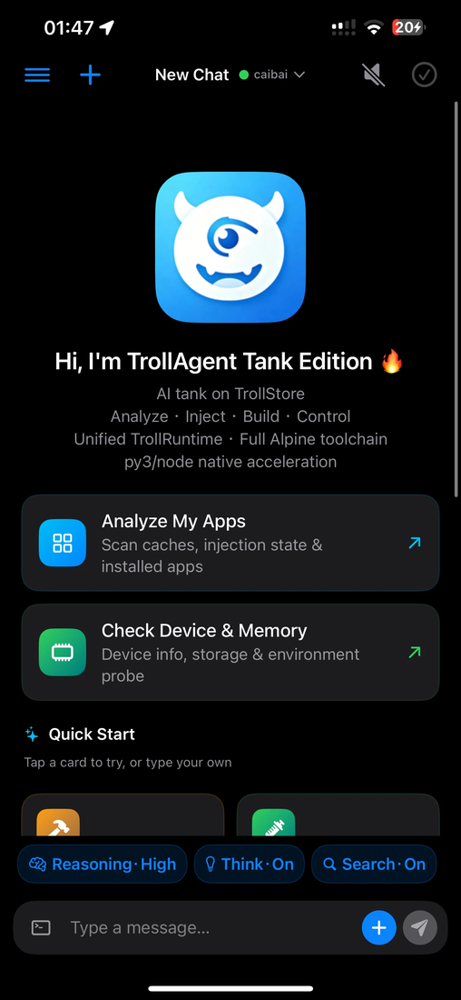
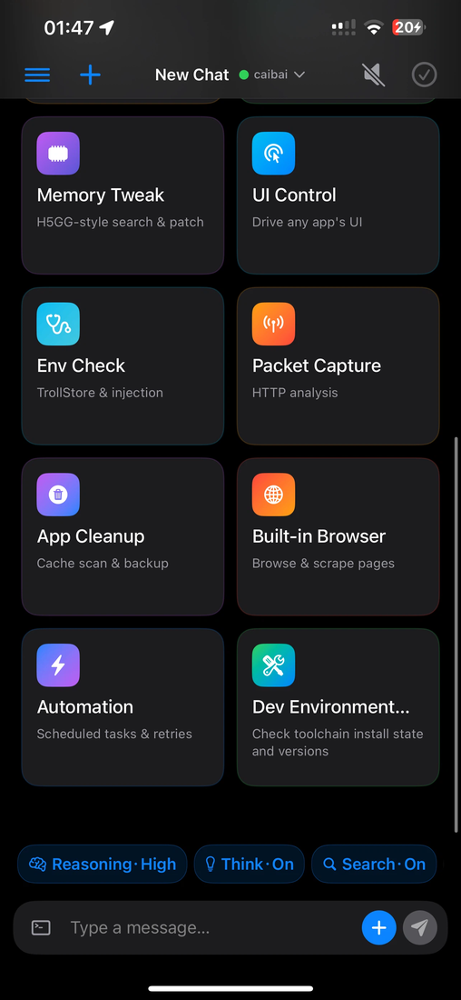
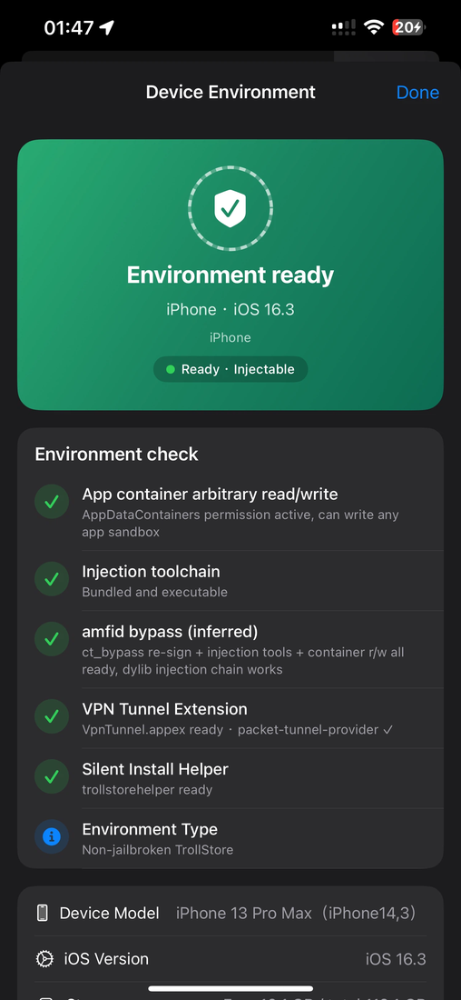
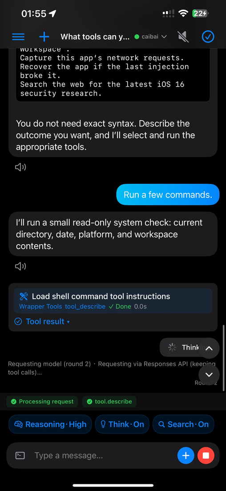
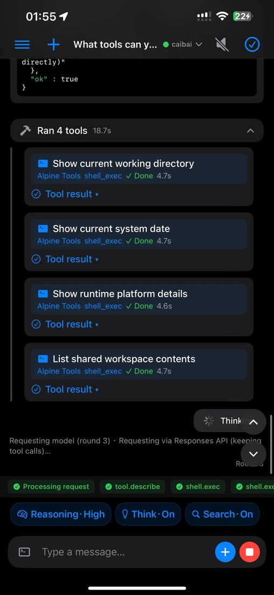
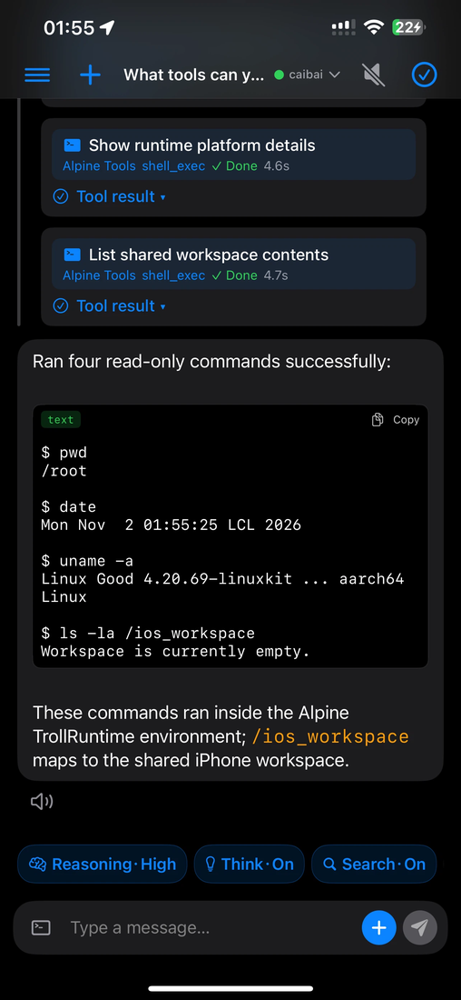

# TrollAgent

**AI-driven iOS experimentation & QA workbench for TrollStore** — Swift + SwiftUI + SwiftPM, runs on iOS 15+ under TrollStore, ships **45 registered tools, 100+ subcommands**, all callable by AI through natural language.

> Zero-learning mode: just say it in plain words ("analyze how this app works", "is this plugin safe", "capture this app's traffic") — the AI picks the tools, installs dependencies, does the job, and gives you a one-line human answer.

<p align="center">
  <a href="https://github.com/zrrt/TrollAgent/releases/download/latest/TrollAgent.tipa"></a>
  
  
  
</p>

---

## Table of Contents

- [Project Overview](#project-overview)
- [Screenshots](#screenshots)
- [Quick Start](#quick-start)
- [Architecture](#architecture)
- [Technology Stack](#technology-stack)
- [Project Structure](#project-structure)
- [Module Details](#module-details)
- [Tool Registry (full list)](#tool-registry-full-list)
- [Technology Integration Roadmap](#technology-integration-roadmap)
- [Build & Release](#build--release)
- [Development Guide](#development-guide)
- [Related Docs](#related-docs)

---

## Project Overview

**TrollAgent** is an AI-driven workbench for the TrollStore ecosystem: it wraps iOS injection, app analysis, decryption, traffic capture, cross-app UI control, device spoofing and more into a set of **native tools callable by AI through natural language**, plus an always-on floating AI voice companion (HUD) over any app.

### Background & motivation

- The iOS reverse-engineering / TrollStore ecosystem historically demanded deep expertise: which tool, which flag, which signing identity, which container path. TrollAgent removes that barrier — the **AI drives every tool** through a unified chat interface.
- Previous generations of iOS automation stacks (iSH emulation, dual-track Alpine routing) were slow, crash-prone and duplicated. TrollAgent moved to a **single unified Linux userspace** (TrollRuntime) and is converging on fully native aarch64 execution (see [Roadmap](#technology-integration-roadmap)).

### Core capabilities

| Area | Description |
|---|---|
| Tool system | 45 native tools / 100+ subcommands, single registration hub, progressive disclosure |
| Unified execution env | Built-in TrollRuntime (unified Linux userspace); the AI can `apk add` any Linux tool and read iOS files directly |
| AI chat | Multiple upstream models (chat/completions, Responses, Gemini — protocol auto-corrected), SSE streaming, reasoning intensity control, skill system, tool batching |
| HUD companion | In-app high-windowLevel floating window (chibi / bunny-girl / cat-girl), full voice loop: STT → AI → Edge TTS, 200+ bilingual bubble lines |
| Remote ops | Gateway WebSocket pairing, SSH tunnel, built-in HTTP terminal, GitHub Actions build & artifact fetch |
| Security | Dangerous-command interception (dual-layer), TCC entitlements passthrough, crash auto-recovery |

### Design principles

- **Zero-learning mode**: natural language straight to results; the AI selects tools and installs dependencies by itself
- **Clean failure boundaries**: high-priority tools return unified `error_code / reason / next_step`, no misleading errors
- **Recoverability**: failed injections auto-rollback + launch self-check (auto-restore on crash)
- **Nativization direction**: progressively retiring iSH/Alpine emulation layers toward aarch64 Linux ELF running directly

---

## Screenshots

### Interface — the workbench

| | | |
|---|---|---|
|  |  |  |
| **Home** — quick cards & one-line input | **Tool cards** — 8 domains, 45 registered tools | **Device Environment** — all-green self-check on non-jailbroken TrollStore (iOS 16.3) |

### AI in Action — one sentence, full pipeline

| | | |
|---|---|---|
|  |  |  |
| **Request** — "Run a few commands." AI plans a read-only check | **Execution** — 4 shell tools run automatically (pwd / date / uname / ls) | **Result** — human-readable answer with Alpine TrollRuntime context |

---

## Requirements & compatibility

| Requirement | Note |
|---|---|
| iOS 15+ | Runs under **TrollStore 2** (jailbreak-friendly) |
| TrollStore 2.x | Install via `.tipa`; **keep TrollStore updated** — older builds re-sign with outdated ldid and can fail on large/complex bundles (e.g. `ldid returned non-zero` on install) |
| iOS 16+ — Developer Mode | TrollAgent ships debugger entitlements (`get-task-allow` / `task_for_pid-allow`) for injection & process control — **iOS 16+ requires Developer Mode enabled** (Settings → Privacy & Security → Developer Mode → enable → **restart**). TrollStore usually arms it automatically and prompts for a restart; a missing restart is the most common cause of a launch crash |
| iOS 17 non-jailbroken note | On iOS 17 non-jailbroken TrollStore, writing into other apps' containers and unsigned-dylib injection are **restricted by the platform** (CoreTrust trust-level change vs iOS 16). Core tools, VPN tunnel and silent install still work; for full capability on iOS 17, jailbreak (Dopamine) is required |

## Quick Start

### Install

1. Build from CI (recommended): every push to `main` triggers GitHub Actions which produces `TrollAgent.tipa` (artifact name `TrollAgent`).
2. Or build locally on macOS: `bash scripts/build-ipa.sh`.
3. Open the `.tipa` in **TrollStore** → install → launch.

### First conversation

| You say | The AI does |
|---|---|
| "Analyze how this app works" | `app diagnose` → injection-residue / encryption / signature checks → explicit report |
| "Is this plugin safe?" | `inject ipa_inspect` / `dylib_inspect` → arch / signature / entitlements / dependencies analysis |
| "Capture this app's traffic" | `network.capture` start → injected NetworkTweak → TLSHook-decrypted request list |
| "What's in this app's data?" | `db list` / `db query` → native sqlite3 read of the app data container |
| "Spoof this app's device model" | `device fake` → in-memory FakeDevice.dylib spoofing (zero residue) |
| "Back it up before uninstalling" | `app duplicate` → silent duplicate via trollstorehelper |

> Model & API key: configured in Settings → Model. Multiple upstream providers supported. The HUD voice loop shares the same configuration via App Group.

---

## Architecture

```
┌────────────────────────────────────────────────────────────┐
│                    UI layer (SwiftUI)                       │
│  ChatView · SettingsView · BrowserView · GatewayView ·      │
│  CleanupView · FakeDeviceView · ControlCenterView · ...     │
└──────────────────────────┬─────────────────────────────────┘
                           │
┌──────────────────────────▼─────────────────────────────────┐
│               AI chat kernel (OpenAIClient)                 │
│  Multi-upstream models · SSE streaming · protocol auto-     │
│  correct (L0-L5 degrade, persisted) · adaptive streaming    │
│  fallback (streamUnsupported memory) · isolated sessions    │
│  · reasoning control · skill system · batched tool select   │
└──────────────────────────┬─────────────────────────────────┘
                           │ tool dispatch (ToolRegistry / MCPCore)
┌──────────────────────────▼─────────────────────────────────┐
│            Tool Registry (45 tools / 100+ subcommands)      │
│  inject · app · file · db · browser · control · device ·    │
│  web · network · vpn · github · tool.install · ...          │
└───┬──────────┬──────────┬───────────┬──────────────────────┘
    │          │          │           │
┌───▼───┐ ┌───▼───┐ ┌────▼────┐ ┌────▼────┐
│Injection││Decrypt ││ Browser ││ Control │
│engine   ││engine  ││WKWebView││Agent.dylib│
│(TrollFools)│(Decrypt)││+JS inject││         │
└───┬───┘ └───┬───┘ └────┬────┘ └────┬────┘
    │         │          │           │
┌───▼─────────▼──────────▼───────────▼───────────────────────┐
│            TrollRuntime (unified Linux userspace)           │
│  Asbestos interpreter · full Alpine toolchain · iOS file    │
│  auto-bind · aarch64 binaries via 3 channels (bundled /     │
│  CI cross-compiled / self-written dylib)                    │
└──────────────────────────┬─────────────────────────────────┘
                           │
┌──────────────────────────▼─────────────────────────────────┐
│              System base (TrollStore mechanics)             │
│  setuid root toolchain (ldid/optool/insert_dylib/ct_bypass) │
│  trollstorehelper silent install · JIT double-ensure · TCC  │
└────────────────────────────────────────────────────────────┘
```

### Core subsystems

| Subsystem | Key components | Responsibility |
|---|---|---|
| UI (SwiftUI) | ChatView, SettingsView, BrowserView, GatewayView, CleanupView, FakeDeviceView, ControlCenterView, AppPickerView… | Full bilingual UI (Simplified Chinese / English) |
| AI chat kernel | OpenAIClient, Models.swift (chat loop), SystemPrompts, UsageRecorder | Multi-upstream chat (chat/completions, Responses, Gemini), SSE streaming, tool selection & **batching**, usage/token accounting, skill system. **Protocol auto-correct**: mismatched upstream protocol detected & corrected per request, result persisted back to shared config (no more per-request L0 reset). **Adaptive streaming fallback**: first-byte timeout (60s main / 10s sub-agent) → non-stream, remembered via `streamUnsupported`. **Per-stream isolated sessions**: fail paths (onError / onComplete) invalidate the session to prevent connection leaks. **Expert fixed-mode**: `protocolAutoFixEnabled` off = respect manual protocol choice; `compatMaxLevel` 0 = fail fast at L0 instead of degrading |
| Tool registry | MCPCore.swift | Single registration hub — **45 registered tools**; default-enabled whitelist (new users productive immediately); progressive disclosure (`isCore`); per-tool enable state; external tool registration (`registerExternalTool`) |
| Sub-agent orchestration | SubAgentManager, `subagent.*` tools (run / status / wait_all / stop / steer) | Independent agent runs with own queue & UI (A/B/C/D aliases); per-call `requestTimeoutOverride` (fast-fail budget); each sub-agent owns an independent session; fail-path invalidation prevents cross-contamination |
| Session store | SessionStore, `conversations.*` tools (list / status / history) | Conversation index & per-session status; per-stream isolated sessions; background handoff (`handoffActiveRequestToBackground`) when the app goes to background |
| HUD companion | HUDManager, GirlCompanion, TTSService, GirlCharacterPickerView | Floating desktop character (Bunny / Chibi / Catgirl), bubble style, quick menu, size control; TTS voice loop (萝莉音 / 猫娘音·御姐 / 兔娘音) shares model config via App Group |
| Domain engines | InjectionExecTool, DecryptEngine, BrowserExecTool, ControlExecTool, AppExecTool, FileExecTool/DbExecTool, network.capture, vpn… | Actual iOS operations: injection (TrollFools), decryption, WKWebView + JS inject, ControlAgent.dylib, silent install, packet capture with TLSHook-decrypted request list |
| Runtime | ShellExecTool + TrollRuntimeEngine | Unified Linux userspace (Asbestos interpreter + full Alpine rootfs + apk ecosystem), iOS file auto-bind, aarch64 binaries via 3 channels |
| System base | Build scripts, ldid/optool/insert_dylib/ct_bypass, trollstorehelper | JIT double-ensure, TCC entitlements, setuid root toolchain, silent install |

### Request lifecycle — one sentence to final answer

| # | Stage | What happens |
|---|---|---|
| 1 | **Input** | User says "Run a few commands." in plain language (zero-learning mode) |
| 2 | **Protocol check** | OpenAIClient verifies the upstream protocol; auto-correct fixes any mismatch along the L0-L5 chain and persists the result; `streamUnsupported` memory skips wasted streaming attempts |
| 3 | **Stream** | SSE request starts (60s first-byte budget for main chat); each request owns an isolated session |
| 4 | **Tool selection** | Model returns tool calls; kernel batches & dispatches through the registry |
| 5 | **Execution** | Domain engine runs the job (Alpine shell, injection, capture…); failures return unified `error_code / reason / next_step` |
| 6 | **Feedback** | Tool result fed back to the model as context; rounds 3-6 repeat until the model emits a final answer |
| 7 | **Render** | Final answer + tool cards rendered; completion sound; session invalidated on close / failure |

### Key design decisions

- **Single registry**: every tool registered in one place (`MCPCore.swift`); default whitelist means new users are productive immediately.
- **Unified execution env**: iSH retired; all shell commands run in TrollRuntime (Asbestos interpreter, full Alpine rootfs + apk ecosystem). No dual-track routing since v6.6.0.
- **JIT double-ensure**: ptrace self-attach (silent) + unconditional TrollStore URL (`apple-magnifier://enable-jit`); waits 3s before the first shell command.
- **Native tool three channels**: bundled binaries / GitHub Actions cross-compilation / self-written dylibs (`inject load_dylib`).
- **TrollStore mechanics**: bundled setuid root toolchain; silent install via trollstorehelper; TCC entitlements passthrough (mic / speech recognition without prompts).
- **HUD separate process**: `ch.xxtou.hudapp` independent binary embedded as a sub-package; App Group shared config; voice loop runs fully on-device.
- **Tool batching (v7.1.99-103)**: read-only/query tools batch up to 4 (executed sequentially, results visible to subsequent calls); state-changing/write tools run one at a time — with dual-layer safety (classification whitelist + dangerous-command interception in ShellTool).
- **Progressive disclosure**: only core tools (shell.exec / control.screenshot) are always resident; the rest are revealed on demand to keep the model context lean.

---

## Technology Stack

| Dimension | Detail |
|---|---|
| Languages | Swift (main app / tools / AI kernel), Objective-C++ (HUD window), C (CHev/CISH/CLaunch/CMitm bridge components) |
| UI | SwiftUI (iOS 15+), full Simplified-Chinese / English bilingual switching (including HUD bubble lines) |
| Platform | iOS 15+ / TrollStore (jailbreak-friendly) |
| Dependency mgmt | SwiftPM |
| Runtime env | TrollRuntime unified Linux userspace (Asbestos interpreter + Alpine toolchain); roadmap target: aarch64 Linux ELF running directly |
| External integration | GitHub Actions (CI build & artifacts), Edge TTS (speech synthesis), multi-upstream LLMs (OpenAI-compatible chat/completions, Responses, Gemini — protocol auto-corrected L0-L5) |
| Process model | Main app + **in-app** high-windowLevel floating window + background keep-alive (`UIBackgroundModes: processing` + `beginBackgroundTask`); standalone HUD sub-process route retired (needs root persona not granted on iOS 16) |
| Injection system | TrollFools-aligned strategy (dylib inject/remove/backup-rollback with `.bak_macho`), in-memory injection (opainject), ControlAgent.dylib cross-app control |
| Network | WebSocket (gateway pairing, Edge TTS), URLSession (downloads with progress), local HTTP terminal `127.0.0.1:8790` |
| Storage | UserDefaults + App Group (`group.com.ai.iosxcode`), sqlite3 direct container reads, file workspace |

---

## Project Structure

```
TrollAgent/
├── Sources/TrollMCP2/            # Main project (145 Swift files)
│   ├── AppMain.swift             # Entry point
│   ├── MCPCore.swift            # Tool registry hub (single registration table, default whitelist)
│   ├── Models.swift             # AI chat kernel (tool selection / batching / execution loop)
│   ├── OpenAIClient.swift       # Multi-upstream model client (SSE / usage stats)
│   ├── ChatView.swift           # Chat UI (model picker sheet)
│   ├── SettingsView.swift       # Settings page
│   ├── BrowserManager.swift     # WKWebView + JS-injection browser
│   ├── DecryptEngine.swift      # App decryption engine (memory dump → repackaged ipa)
│   ├── ControlTools.swift       # Cross-app UI control (ControlAgent)
│   ├── CleanupTools.swift       # System cleanup
│   ├── GatewayClient.swift      # Gateway WebSocket pairing
│   ├── GitHubAccountStore.swift # GitHub Actions build / artifact fetch
│   ├── AppPickerView.swift      # App picker (search / category / index)
│   ├── GirlCompanion.swift      # Desktop companion character logic
│   ├── AppTools.swift           # app.* subcommands (launch/diagnose/install/decrypt...)
│   ├── FileDbTools.swift        # file/db container access
│   ├── BridgeTools.swift        # tool.install / env.setup_re / native chip bridging
│   ├── BuildTools.swift         # github.* CI tooling
│   ├── AdvancedTools.swift      # system.exec_root / download
│   └── ... (tools split by domain: ArchiveTools/CleanupTools/DiagnoseAndServer/...)
├── HUD/                         # Floating companion (Objective-C++)
│   ├── sources/HUDRootViewController.mm  # Voice loop / character animation
│   ├── HUD/Resources/           # Character assets (chibi / bunny-girl / cat-girl:
│   │                           #  idle/blink/talk/sit/kneel/climb/jump/fall/side...
│   │                           #  incl. bunny-girl sitting pose rabit_chin_sit.png)
│   └── supports/entitlements.plist  # TCC + application-groups
├── CHev/ CISH/ CLaunch/ CMitm/  # C bridge components
├── scripts/                     # Build & QA scripts
│   ├── build-ipa.sh             # Local macOS build → TrollAgent.ipa
│   ├── build-hud.sh             # HUD sub-package build
│   ├── verify_ipa.py            # IPA structure verification
│   ├── check_tool_registration.py  # Registry consistency check
│   ├── check_braces.py / check_swift_braces.py / check_tweak_braces.py  # Syntax guards
│   ├── gen_icons.py             # Icon generation
│   ├── build-openssl.sh         # OpenSSL cross-build
│   ├── git.py / nscan.py / patch_keychain_wipe.py  # CI helpers
│   └── ish-build/               # (retired iSH build tree)
├── Resources/                   # Assets
├── Support/Info.plist           # Version (CFBundleShortVersionString)
├── benchmark/ build_out/        # Benchmarks / build output
└── *.md                         # Docs (README/GOALS/DEV_HANDOVER/FAQ...)
```

---

## Module Details

### 🧩 Injection & automation (TrollFools-aligned)
- `inject` (enable / disable / remove / restore / enable_persisted / status / inspect / list): dylib injection, removal, backup-restore with automatic `.bak_macho` rollback
- `inject verify`: post-injection health check (Mach-O load commands + process liveness + crash detection); `inject static`: Mach-O static analysis
- `inject mem`: in-memory injection (opainject, zero file residue); `hook_apply` / `probe_inspect`; `inject load_dylib`: load your own dylib
- `rescue` (scan / recover_all / cleanup): emergency recovery against "app won't open after injection"
- Failed injections auto-rollback + post-injection launch self-check (auto-restore on crash)

### 📱 App management
- `app` (launch / stop / restart / status / stats): process control (3-tier start fallback: `open -b` → direct exec → url scheme)
- `app diagnose`: auto root-cause for launch failures (injection residue / encryption / signature / crash scene → explicit `next_step`)
- `app install / uninstall / duplicate`: AI install / uninstall / duplicate (silent install via trollstorehelper first)
- `app encrypt_info / decrypt / replace_decrypted / restore_binary`: built-in decryption engine (`task_for_pid` + `vm_read` memory dump → rebuilt decrypted image → packaged ipa)
- `app entitlements / deps / cache_inspect / cache_clear / launch_options / inject_package`
- `inject ipa_inspect / dylib_inspect`: IPA/dylib parsing (arch / signature / entitlements / dependencies, telling "parse failed" apart from "genuinely absent")

### 🧹 System cleanup
- Storage ring card + 6 cache categories + quick/advanced cleanup tabs + one-tap cleanup (setuid root full-directory rebuild)

### 📂 Filesystem & data
- `artifact` (read / write / list): workspace file management
- `bind_app` / `bind_app_write` / `app_write_file`: read-only / backup-first writable container binding

### 🌐 Browser (WKWebView + JS injection, Playwright-style)
- `browser` (status / navigate / screenshot / snapshot / text / click / type / submit / scroll / wait / wait_for) + absolute XPath for elements
- `browser form_fields / fill_form`: full-form autofill (React/Vue-compatible value setter + events)
- `browser adblock / clear`: ad/tracker blocking (WKContentRuleList) + cache/Cookie clearing; `navigate` supports `fresh=true` to bypass cache

### 🎮 Device spoofing (GreenShield-style)
- `device fake / restore`: in-memory FakeDevice.dylib to spoof UIDevice model (zero residue, resets on reboot)
- `device advertising / idfv`: ad identifiers / IDFV; `inject keychain_wipe`: keychain cleaning

### 🛡️ Security detection
- `device info / probe / snapshot`: full checks for TrollStore / task_for_pid / container read-write / injection toolchain

### 🔌 Cross-app UI control
- `control` (inject / status / ui_tree / screenshot / tap / swipe / type / key / tap_text / type_text)
- Injects ControlAgent.dylib → localhost:4789 HTTP API (/status /ui_tree /tap /swipe /type)
- **UI tree model**: UIView subviews recursion (frame / class / text); **roadmap: mixed mode** — add in-process AX reads (`view.accessibilityElements` / `UIAccessibilityCopyElementAtPoint`) for semantic roles, so the tree "understands" the screen like a human (Android-accessibility / Mika-style)

### 🏗️ Build & engineering
- `tool.install`: unified tool install loop — one-click in the unified environment (apk→pip→CI; CI cross-compiles native iOS binaries best-effort)
- `env.setup_re`: one-click reverse-engineering toolchain (binutils/file/python3/sqlite/tcpdump/7z…)
- `github` (account_status / trigger_build / fetch_runs / download_artifact): trigger GitHub Actions, watch progress, grab artifacts — the CI builds and ships TrollAgent.tipa
- `project`: workspace project management
- `system.exec_root`: system-side Mach-O execution (jroot jailbreak tooling)

### 🤖 AI & models
- Multiple upstream models (chat/completions, Responses, Gemini — protocol auto-corrected), SSE streaming word-by-word output, reasoning intensity control
- Tool batching: read-only/query tools batch (up to 4, executed sequentially); state-changing/write tools run one at a time (double-layer safety)
- Skill system: `skills.list` / `skills.read` / `skills.set_enabled` (reusable standard workflows)
- Usage accounting: per-request token display (real `usage` preferred, estimated fallback)

### 📡 Gateway & automation
- Gateway WebSocket pairing, multi-node calls, `automation` (run / list / jobs / stop / status / history / set_enabled), `ssh` (exec / scp)
- **Remote terminal service**: built-in HTTP terminal on `127.0.0.1:8790` (/api/tools), reachable from a browser or via SSH tunnel

### 📊 Network & diagnostics
- `web.search` (multi-engine fallback Bing→DuckDuckGo→Baidu, parallel `queries`, source-graded `sort`, results into knowledge base via `save`)
- `web.fetch` (auto article extraction, article/main first + built-in browser fallback)
- `network.capture` (start / stop / requests / analyze): NSURLSession capture via injected NetworkTweak; TLSHook decrypts SSL_read/SSL_write
- `vpn.capture`: system-proxy capture — the reliable path is the local proxy (WiFi manual proxy `127.0.0.1:18180`)
- `diagnose` (startup / injection), crash log parsing
- `wifi_proxy`: WiFi proxy management

### 📚 Knowledge & system
- `knowledge` (import_text / import_file / search / delete / clear): knowledge base CRUD
- `memory` (search / modify / freeze), `assistant_memory` (cross-session memory)
- `location` (get / fake / status / clear), `reminder` (create / schedule / recurring)
- `memory_tweak`: in-memory tweak tooling

### 🐰 Desktop companion (HUD)
- Floating anime companion (chibi / bunny-girl / cat-girl) on top of any app: idle frames, wall-climbing, bubble chat
- Full voice loop: STT → AI → Edge TTS; speech-animation reset, sitting/voice-hold pose assets (`<prefix>_chin_sit` fallback for bunny-girl)
- 200+ bilingual bubble lines (time greetings, weather, moods, interactions) that follow the app language setting
- Quick menu to launch WeChat / Douyin / AI chat / hide, resizable, draggable, multi-gesture interactions
- Character asset set: idle / blink / talk / sit / kneel / climb / jump / fall / side / heart / surprise / giggle… (~30 frames per character)

---

## Tool Registry (full list)

45 registered tool objects, all default-enabled for new users (a subset shown below, grouped by domain):

| Tool | Purpose | Key subcommands |
|---|---|---|
| `shell.exec` | Unified shell (TrollRuntime) | any Linux command; `apk add` installs |
| `app` | Process control & app analysis | launch / stop / restart / status / diagnose / install / uninstall / duplicate / decrypt / entitlements / deps |
| `inject` | dylib injection | enable / disable / remove / restore / mem / verify / static / load_dylib / hook_apply / ipa_inspect / dylib_inspect |
| `control` | Cross-app UI control | inject / ui_tree / screenshot / tap / swipe / type / key |
| `browser` | In-app browser | navigate / snapshot / text / click / type / submit / form_fields / fill_form / adblock / clear |
| `device` | Device info & spoofing | info / probe / snapshot / fake / restore / advertising / idfv |
| `bind_app` / `bind_app_write` | Container binding | read-only / backup-first writable |
| `app_write_file` | Direct file write | with pre-write backup |
| `artifact` | Workspace files | read / write / list |
| `network.capture` | Traffic capture | start / stop / requests / analyze |
| `vpn.capture` | System-proxy capture | start / stop / analyze |
| `wifi_proxy` | WiFi proxy | set / clear |
| `web.search` | Web search | multi-engine fallback, parallel queries |
| `web.fetch` | Page fetch | auto article extraction |
| `github` | CI builds | account_status / trigger_build / fetch_runs / download_artifact |
| `tool.install` | Unified tool install | apk→pip→CI loop |
| `env.setup_re` | RE toolchain setup | one-click |
| `system.exec_root` | Mach-O execution | jroot tooling |
| `ssh` | Remote shell | exec / scp |
| `automation` | Automations | run / list / jobs / stop / status / history / set_enabled |
| `project` | Project management | workspace ops |
| `diagnose` | Failure diagnosis | startup / injection |
| `rescue` | Injection recovery | scan / recover_all / cleanup |
| `memory` / `assistant_memory` | Memory | search / modify / freeze |
| `knowledge` | Knowledge base | import_text / import_file / search / delete / clear |
| `location` | Location | get / fake / status / clear |
| `reminder` | Reminders | create / schedule / recurring |
| `skills.*` | Skill system | list / read / set_enabled |
| `subagent.*` | Sub-agent orchestration | run / status / wait_all / stop / steer |
| `audit` | Code audit (Swift/SwiftUI signal scan) | run / status |
| `conversations` | Session index | list / status / history |
| `shell.stop` | Kill runaway shell | — |

---

## Technology Integration Roadmap

**Long-term goal** (see [GOALS.md](GOALS.md)): **full nativization** — abolish the iSH/Alpine dual-track routing, ultimately run aarch64 Linux ELF directly so the AI perceives a single environment.

| Phase | Status | Notes |
|---|---|---|
| P1 Unified userspace | ✅ done | TrollRuntime (Asbestos interpreter) took over; iSH emulation retired |
| P2 Dual-track routing convergence | ✅ done (v6.6.0) | Routing abolished + unified env layer landed: runtime param removed, ISHEngine → TrollRuntimeEngine, iSH copy cleared; CELF/elf-runner/static busybox retired |
| P3 Full nativization | 🎯 target | aarch64 Linux ELF running directly; the AI perceives a single environment (N1 gateway LAN tunneling for debugging) |
| Supporting | ongoing | Tool batching, adaptive streaming fallback (`streamUnsupported`), protocol auto-correct (L0-L5, persisted), per-stream isolated sessions, sub-agent orchestration, HUD voice loop, versioned build & release (7.1.x auto-bump) |
| ControlAgent mixed UI tree | roadmap | UIView subviews recursion (full frame/class) + **in-process AX reads** (`view.accessibilityElements` / `UIAccessibilityCopyElementAtPoint`) for semantic roles — the tree "understands" the screen like a human, Android-accessibility / Mika-style |

### Historical timeline (unification, v6.5.0 → v6.6.0)

- **v6.5.0** — core switch to rcarmo/ios-linuxkit **Asbestos** (ARM64 interpreter branch of iSH, no JIT, iOS W^X compliant): full Alpine rootfs + apk ecosystem + full dynamic ELF support, device-verified.
- **v6.6.0 (fix1-9)** — unified environment landed: CELF / elf-runner / static busybox / iSH routing **all retired**; `shell.exec` has no runtime param — all commands default to TrollRuntime; iOS-specific commands auto-handled natively; rootfs completed; native-chip tools cleared (lua/node/r2/cstool/llvm family — Alpine replaces them); CI 25-45 min faster.
- **Key decision (2026-10-17→10-23)**: the busybox static-ELF route (emu.c/CELF) retired — composed commands' final form = P5 ELF runtime (Linux shell semantics for free); self-written Swift shell unnecessary; fork verified to hang on native iOS (python3 subprocess NO JSON).

### Recent milestones (7.1.x)

| Version | What landed |
|---|---|
| 7.1.88-90 | HUD voice-loop polish: wall-climb guard fix (speech no longer stuck), back-to-idle after playback (`audioPlayerDidFinishPlaying`), bunny-girl sitting pose asset fallback (`<prefix>_chin_sit`) |
| 7.1.91-92 | UI fixes: app icons fill rounded corners (`scaledToFill` + clipShape), device-spoofing target picker (full AppPickerView with search/category/A-Z index) |
| 7.1.93-97 | Performance & navigation: removed HUD diag log real-time reads, model-manager jump fixes (delayed push → in-sheet `NavigationLink`), saveAndTest → lightweight connectivity test, upstream-model fetch in the model picker, update-install now jumps to TrollStore (main-thread fix) |
| 7.1.98 | Usage-stats token display: real `usage` captured in `OpenAIClient`, per-request "≈N tok" rendering |
| 7.1.99-103 | Tool batching for throughput: read-only batch ≤4, interpreter batching with script blacklist, audit fixes for env/curl/kill/sed — double-layer safety (classification + dangerous-command interception) |
| 7.1.266-275 | Deep audit — 11 logic fixes shipped in one release: pluggable closed-loop, tool-failure `isError` false-kill, SSL auto-retry, URL force-unwrap ×3, APPEND / UPDATE-FAIL fallbacks, completion-sound timing, token accounting precision, zip cross-session pollution, sub-agent SSL no-op, closure `self.` compile fix |
| 7.1.276-277 | Rendering fixes (list/quote wrapping truncation, table max-height removed) + protocol dead-loop root fix (auto-correct result persisted back to shared config — no more per-request L0 reset) |
| 7.1.278 | 60s main-chat streaming + `streamUnsupported` memory (first-byte timeout → non-stream, remembered); expert fixed-mode (`protocolAutoFixEnabled` / `compatMaxLevel`); device reading fixes (physical pixels, storage capacity); per-stream isolated sessions with fail-path release; floating arrows ︿﹀ |
| 7.1.279 | Encapsulated-tool icons → blue flat `.fill` set (tool-prefix branches) |
| 7.1.280 | HUD character English name Loli → Chibi (avoid lolicon association); repo facade (README badges / compatibility table / 45 tools / screenshots / architecture / LICENSE / Credits) |

---

## Build & Release

### Local build (macOS)

```bash
bash scripts/build-ipa.sh          # → TrollAgent.ipa (installable via TrollStore)
bash scripts/build-hud.sh          # → HUD sub-package
```

### CI release flow

- Every push to `main` triggers **GitHub Actions**.
- The workflow bumps `CFBundleShortVersionString` (+1, commit `[skip ci]`), so **the artifact version is always the submitted version + 1**.
- CI accepts `RELEASE_VERSION` to auto-inject the release version (fixes version drift).
- Artifacts: `TrollAgent` zip containing `TrollAgent.tipa` (~163 MB). The `latest` release tag is overwritten on every build.
- QA guards run in CI: `verify_ipa.py` (IPA structure), `check_tool_registration.py` (registry consistency), brace checks.

### Versioning convention

- `Support/Info.plist` → `CFBundleShortVersionString`; bump per feature batch.
- Commit convention: `7.1.x: <what landed>`. Docs-only changes carry their own message.

---

## Development Guide

### Getting started

1. Open the repo in Xcode (SwiftPM layout under `Sources/TrollMCP2/`).
2. Signing: TrollStore signing handled by build scripts (`ldid -S` with `Support/TrollAgent.entitlements`); no developer account needed.
3. HUD is a separate source tree (`HUD/`, Objective-C++ floating-window framework) integrated in-app (standalone process route retired).

### Code conventions

- Tools are registered once in `MCPCore.swift`; new tools must also land in the default whitelist if meant to be available out of the box.
- High-priority tools return unified `error_code / reason / next_step`; never return a misleading success.
- Keep the unified environment in mind: shell commands run in TrollRuntime (Alpine), not on iOS natively — iOS-specific needs go through dedicated tools.
- `check_tool_registration.py` / brace checks must pass before push.

### Common pitfalls

- Version drift: always let the workflow bump, or pass `RELEASE_VERSION` explicitly.
- HUD config is per-process: read/write model config via App Group `group.com.ai.iosxcode`, not plain UserDefaults.
- `.waitingForConnectivity` (not `.waiting`) is the correct `URLSession` readiness value.

---

## Credits

Built with & thanks to these open-source projects and authors (mirrors the in-app About → Open Source Credits):

| Project | Author | Used for |
|---|---|---|
| [TrollFools](https://github.com/Lessica/TrollFools) / [ElleKit](https://github.com/tealbathingsuit/ellekit) | Lessica / Evelyn | Injection engine |
| [Theos](https://github.com/theos/theos) | Theos team | Build toolchain |
| [ldid](https://github.com/opa334/ldid) / [insert_dylib](https://github.com/Tyilo/insert_dylib) / [optool](https://github.com/alexzielenski/optool) | opa334 / Tyilo / alexzielenski | Sign & inject |
| ct_bypass / Shadow | — | iOS 17+ bypass |
| [class-dump](https://github.com/nygard/class-dump) / [Frida](https://github.com/frida/frida) | Steve Nygard / Frida team | Reverse engineering |
| H5GG / GameGuardian | — | Game memory |
| [OpenSSL](https://github.com/openssl/openssl) | OpenSSL team | MITM decrypt |
| [hev-socks5-tunnel](https://github.com/heiher/hev-socks5-tunnel) / [Tun2SocksKit](https://github.com/EbrahimTahernejad/Tun2SocksKit) | heiher / EbrahimTahernejad | VPN tunnel |
| [cloudflare-edge-tts](https://github.com/DIYgod/cloudflare-edge-tts) | DIYgod | AI TTS relay |
| [RSKGrowingTextView](https://github.com/ruslanskorb/RSKGrowingTextView) | Ruslan Skorb | Chat input |
| [ZIPFoundation](https://github.com/weichsel/ZIPFoundation) | Thomas Zoechling | Zip archive |
| [ios-linuxkit Asbestos](https://github.com/rcarmo/ios-linuxkit) | Rui Carmo (rcarmo) | TrollRuntime ARM64 interpreter (unified env core since v6.5.0) |
| [Alpine Linux](https://alpinelinux.org) | Alpine team | TrollRuntime rootfs (aarch64 Linux userspace) |
| [iSH](https://github.com/ish-app/ish) | iSH team | Earlier emulation engine (retired since v6.6.0) |
| [TrollSpeed](https://github.com/Lessica/TrollSpeed) | Lessica | HUD floating-window framework (MIT, base of the desktop mascot) |
| [GitHub Actions](https://github.com/features/actions) | GitHub | Cloud build |

Agent-loop design reference: [Open Minis](https://openminis.app/) — per-stream isolated sessions, sub-agent delegation & progress tracking. Pluggable tool/registry architecture reference: [DeepSeek Harness (dsh)](https://github.com/deepseek-ai/deepseek-harness). HUD floating-window interaction reference: [TheBall (nate-parrott/ball)](https://github.com/nate-parrott/ball). Also [TrollStore](https://github.com/opa334/TrollStore) for install / sign mechanics.

And every open-source contributor — thank you.

---

## Related Docs

- [GOALS.md](GOALS.md) — long-term goals and architecture evolution (unification decisions, roadmap status)
- [FAQ.md](FAQ.md) — JIT, unified environment, known issues
- [DEV_HANDOVER.md](DEV_HANDOVER.md) — dev handover doc (blockers/fixes/next steps)
- [AGENTS.md](AGENTS.md) / [RULES.md](RULES.md) — AI collaboration conventions
- [HUD_PROGRESS.md](HUD_PROGRESS.md) — HUD development progress
- [VPN_DEVLOG.md](VPN_DEVLOG.md) — VPN capture dev log
- [CORUNA_INTEGRATION.md](CORUNA_INTEGRATION.md) — Coruna integration notes
